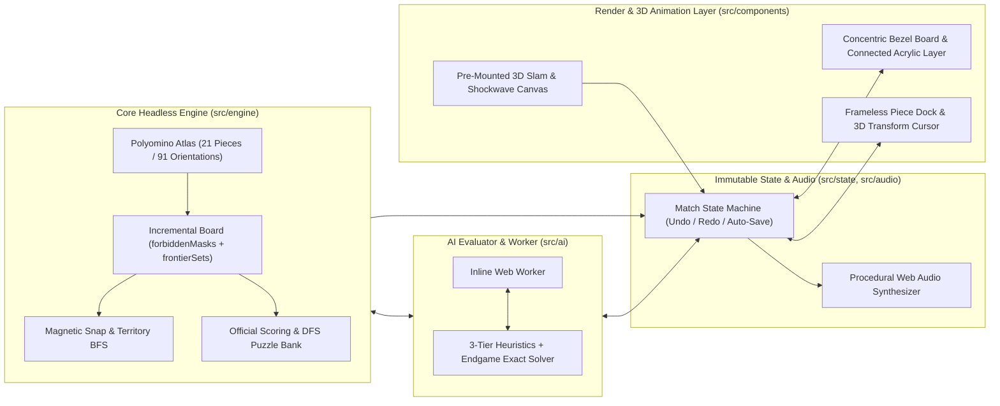

# Blokus

极简拟物风角斗士棋（Blokus）现代重制版——融合注塑半透明聚碳酸酯棋子质感、3D 刚体砸屏转场与解耦无头博弈引擎。

[](https://react.dev/)
[](https://www.typescriptlang.org/)
[](https://vite.dev/)
[](https://tailwindcss.com/)
[](https://workers.cloudflare.com/)
[](./LICENSE)

> **▶ Live Demo（在线试玩）：[https://blokus.patrick091210.workers.dev](https://blokus.patrick091210.workers.dev)**

---

## 核心特性（Features）

- **拟物亚克力质感与极简无形 UI**：四邻域连通计算生成一体成型多联骨牌（零内部黑缝 + 半透明折光刻度槽），单位格内嵌 58% 同心阶梯折光台面，85% 光学通透度自然透出底层 `135°` 凸起十字卡槽；以棋盘外角呼吸光与等宽滚动数字取代传统弹窗与横幅。
- **3D 物理砸屏开场**：纯 GPU 合成层驱动的三段式开场编排——六面体立体五格骨牌高空俯冲、双层低频 Web Audio 碰撞合成音、阻尼震屏与预挂载模式卡片欠阻尼弹簧无缝展开。
- **解耦规则引擎（Headless Engine）**：零 UI 依赖纯函数引擎，静态预计算 21 枚骨牌的 91 种非对称唯一形态，增量维护正交禁区掩码（`forbiddenMasks`）与对角前沿集合（`frontierSets`），内置死子实时置灰检测、2 格半径磁吸落点预览与官方 +15/+20 清盘加分判定。
- **多模式与启发式 AI**：覆盖单人挑战（20×20 经典四色）、双人决斗（14×14 Blokus Duo / 20×20 双色联控）、四人混战（2 真人 + 2 AI / 4 人同屏）与 6 关 DFS 验证残局闯关；内联 Web Worker 异步运行三梯度启发式 AI（含终局精确求解器），主线程全程满帧无阻塞。

---

## 架构图（Architecture）



---

## 操控速查表（Controls）

| 交互动作 | 鼠标 / 触控操作 | 键盘快捷键 |
| :--- | :--- | :--- |
| **拾取 / 切换棋子** | 左键点击右侧悬浮棋子坞，或直接按住棋子拖向棋盘 | — |
| **磁吸预览与落子** | 棋盘悬停自动吸附半径 2 格内合法角点；左键点击或松手落子 | — |
| **顺时针 / 逆时针旋转 90°** | 持子悬停棋盘时上下滚动鼠标滚轮 | `R` / `Shift + R` |
| **180° 3D 立体镜像翻转** | 持子悬停棋盘时右键点击 | `Space` 或 `F` |
| **放下当前棋子 / 返回菜单** | 再次点击棋子坞中当前高亮棋子槽位 | `Esc`（未持子时返回模式页） |
| **悔棋回退** | 点击左上角微光 `↶` 按钮 | `Z` |
| **深色 / 浅色台面切换** | 点击右上角黑白微圆点（右侧附静音开关） | — |

---

## 本地运行与部署指南（Quick Start & Deployment）

### 环境要求
- **Node.js** >= 22（原生支持 TypeScript 单元测试运行器 `node --test`）
- **npm** >= 10

### 本地开发与校验

```bash
# 1. 安装项目依赖
npm install

# 2. 启动本地热更新开发服务器
npm run dev

# 3. 运行核心规则引擎、AI 与状态机单元测试（14 项断言）
npm test

# 4. 执行生产环境单文件构建（输出至 ./dist）
npm run build
```

### 部署至 Cloudflare Workers

项目采用 Cloudflare Workers 原生 Static Assets 架构（配置文件见 [`wrangler.jsonc`](./wrangler.jsonc)），一键完成构建与全球边缘节点发布：

```bash
# 首次使用需登录 Cloudflare 账号授权
npx wrangler login

# 构建生产包并发布至 Cloudflare Workers (服务名: blokus)
npm run deploy
```

---

## License

Released under the [MIT License](./LICENSE).
